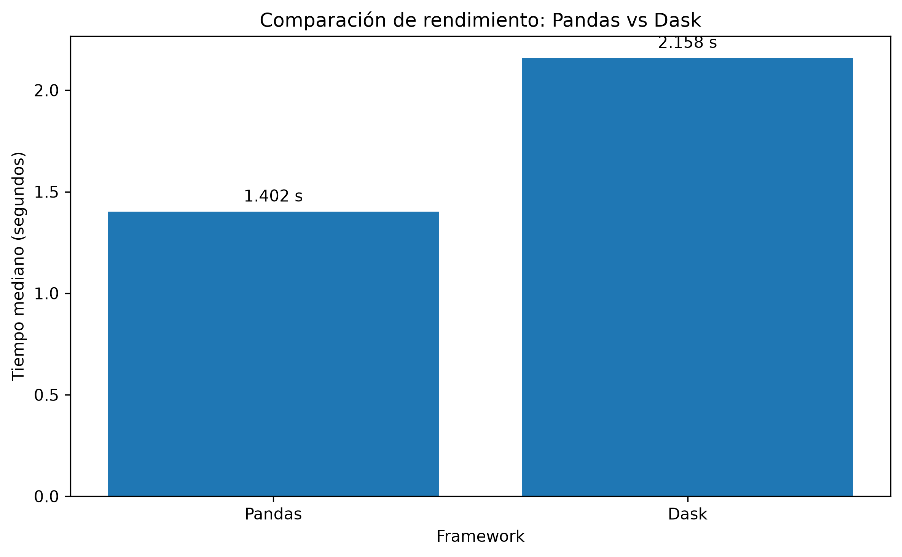
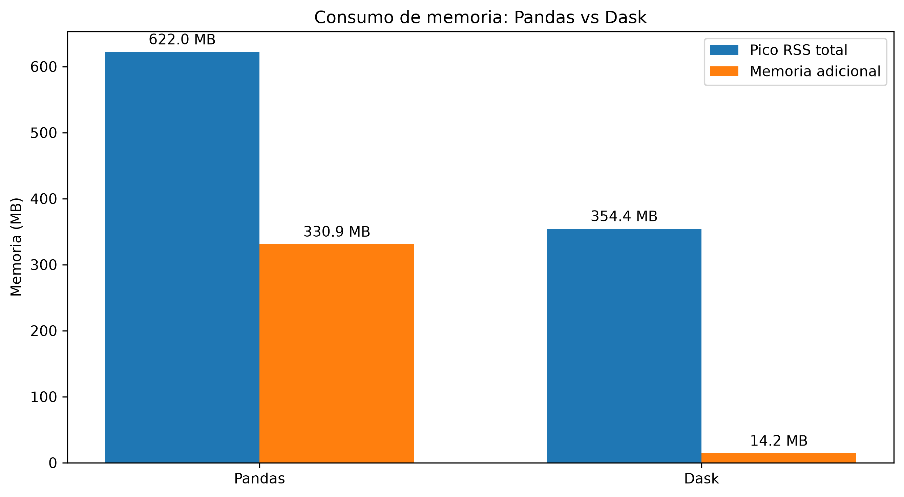
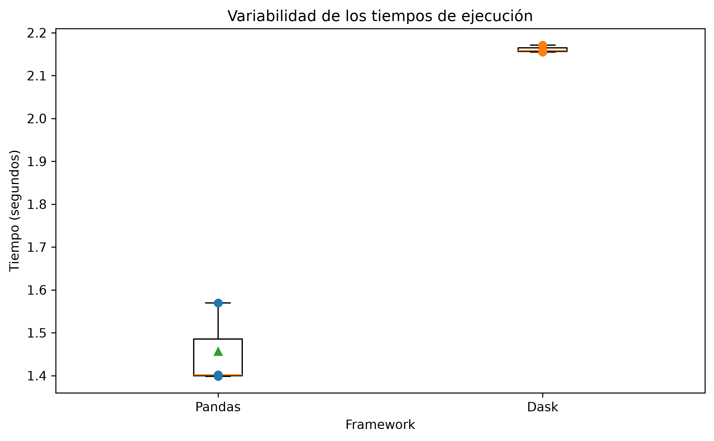

# Benchmark de rendimiento: Pandas vs Dask

## 1. Objetivo

Evaluar el rendimiento de Pandas y Dask durante el procesamiento de reseñas de clientes, comparando el tiempo de ejecución y el consumo de memoria RAM bajo las mismas condiciones.

El experimento permite observar las diferencias entre el procesamiento tradicional en memoria y el procesamiento paralelo mediante particiones.

## 2. Entorno de ejecución

El benchmark se ejecutó utilizando el conjunto de datos procesado de Sentiment360, almacenado en formato Parquet.

| Característica | Valor |
|---|---|
| Registros | 200,000 reseñas |
| Archivos | Parquet |
| Tamaño del dataset | 20.56 MB |
| Sistema operativo | Linux Mint / Ubuntu 24.04 base |
| RAM total | 7.65 GB |
| RAM disponible al registrar el entorno | 2.50 GB |
| Núcleos físicos | 2 |
| Núcleos lógicos | 4 |
| Ejecuciones por tecnología | 3 |

## 3. Metodología

Se implementó la misma operación lógica en ambos frameworks:

1. Filtrado de reseñas con texto no nulo y no vacío.
2. Cálculo de la longitud de cada reseña.
3. Cálculo de la cantidad de palabras.
4. Agrupación por etiqueta de sentimiento.
5. Obtención del total de reseñas y los promedios de longitud y cantidad de palabras.

Se realizaron tres ejecuciones por tecnología y se utilizó la mediana de los tiempos para reducir la influencia de variaciones puntuales.

La equivalencia de los resultados se comprobó mediante:

- Comparación de las etiquetas.
- Comparación exacta de los conteos.
- Comparación numérica de los promedios mediante `numpy.testing.assert_allclose`, utilizando `rtol=1e-5` y `atol=0`.

También se registraron los tiempos individuales, el pico de memoria RSS del proceso y el incremento de memoria respecto a la medición inicial de cada ejecución.

**Consideración metodológica:** ambas estructuras de datos se preparan antes de iniciar las mediciones. Por tanto, las mediciones de memoria representan el consumo del proceso Python completo durante cada operación, no el consumo aislado de cada biblioteca. El muestreo periódico también puede omitir picos de memoria muy breves.

## 4. Resultados

### 4.1. Tiempo de ejecución

| Ejecución | Pandas (s) | Dask (s) |
|---|---:|---:|
| 1 | 1.401690 | 2.158424 |
| 2 | 1.398224 | 2.154679 |
| 3 | 1.569344 | 2.171031 |
| **Mediana** | **1.401690** | **2.158424** |

Pandas presentó un tiempo mediano aproximadamente un 35.1 % menor que Dask.

La relación de rendimiento obtenida fue de 0.6494, calculada como el tiempo mediano de Pandas dividido entre el tiempo mediano de Dask.



### 4.2. Consumo de memoria

| Indicador | Pandas | Dask |
|---|---:|---:|
| Pico RSS mediano (MB) | 622.02 | 354.36 |
| Memoria adicional mediana (MB) | 330.92 | 14.25 |

Las mediciones registraron un incremento de memoria menor durante las ejecuciones de Dask. Sin embargo, debido a que ambas estructuras permanecen preparadas en el mismo proceso, estos valores deben interpretarse como observaciones del proceso completo y no como una comparación aislada del consumo interno de cada framework.



### 4.3. Variabilidad de las ejecuciones

Las tres ejecuciones permitieron observar la variación del tiempo de procesamiento en cada tecnología.



Pandas presentó tiempos entre 1.398224 y 1.569344 segundos, mientras que Dask registró tiempos entre 2.154679 y 2.171031 segundos.

Estas observaciones corresponden a un conjunto de tres ejecuciones y no constituyen una evaluación estadística extensa.

## 5. Verificación de equivalencia

Los resultados generados por ambos frameworks fueron equivalentes.

| Etiqueta | Total de reseñas | Longitud promedio | Palabras promedio |
|---|---:|---:|---:|
| 0 | 40,000 | 152.883475 | 28.470575 |
| 1 | 40,000 | 168.438750 | 31.293075 |
| 2 | 40,000 | 155.380300 | 28.822900 |
| 3 | 40,000 | 142.357200 | 25.878525 |
| 4 | 40,000 | 137.454825 | 24.533275 |

La validación numérica finalizó correctamente con `equivalent_results: true`.

## 6. Análisis de resultados

Para el volumen evaluado, Pandas presentó menor tiempo de ejecución. Esto puede explicarse por el tamaño relativamente reducido del dataset y la baja sobrecarga de sus operaciones en memoria.

Dask, por su parte, incorpora mecanismos de particionamiento y planificación de tareas que pueden introducir costos adicionales cuando el volumen de información no justifica su paralelización.

Las mediciones de memoria mostraron un menor incremento durante las ejecuciones de Dask, aunque este resultado debe interpretarse considerando las limitaciones del método de medición empleado.

Por tanto, los resultados no permiten concluir que una tecnología sea universalmente superior a la otra. La elección depende del volumen de información, la memoria disponible, la infraestructura y las características del procesamiento.

## 7. Conclusión

El benchmark permitió comprobar que Pandas y Dask producen resultados equivalentes al aplicar las mismas operaciones sobre las 200,000 reseñas de Sentiment360.

En el entorno evaluado, Pandas obtuvo un menor tiempo mediano de ejecución, mientras que Dask presentó un menor incremento de memoria RSS durante las operaciones medidas.

Estos resultados muestran que Pandas puede ser suficiente y eficiente para conjuntos de datos que caben cómodamente en memoria, mientras que Dask ofrece capacidades de procesamiento por particiones que pueden resultar útiles al trabajar con volúmenes mayores.

La evaluación también demuestra la importancia de comparar las tecnologías utilizando las mismas operaciones, datos y métricas, en lugar de asumir que el procesamiento distribuido siempre implica una mayor velocidad.

## 8. Reproducibilidad

El benchmark puede ejecutarse desde la raíz del repositorio mediante:

```bash
python -m src.evaluacion.benchmark_dask_pandas \
    --dataset data/processed/reviews \
    --repetitions 3
```

Los resultados se almacenan automáticamente en:

- `reports/benchmark/resultados.json`
- `reports/figures/benchmark_tiempos.png`
- `reports/figures/benchmark_memoria.png`
- `reports/figures/benchmark_estabilidad.png`
