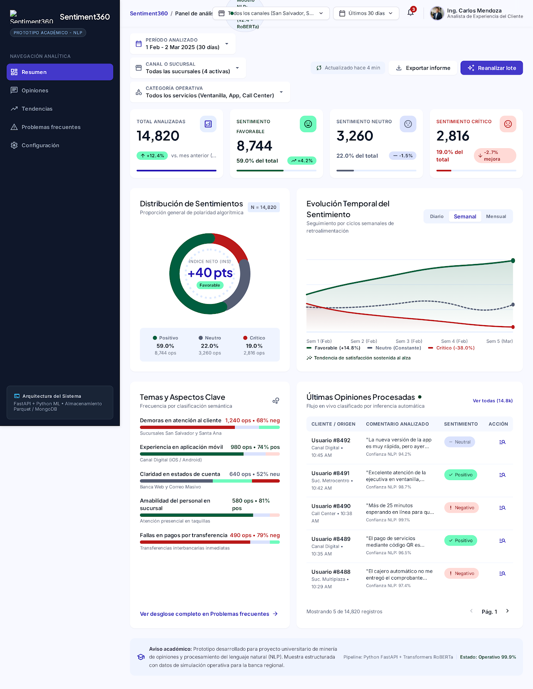
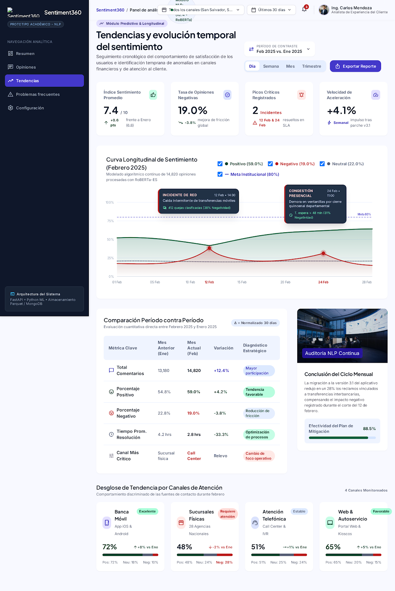
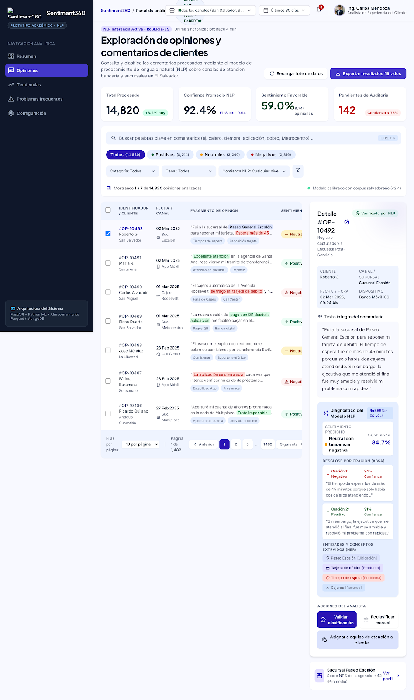
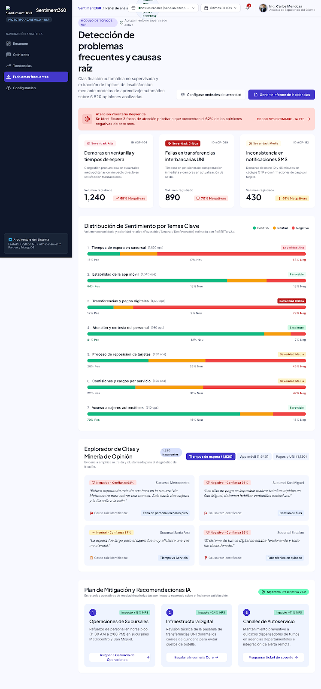

# Prototipo de Sentiment360

## 1. Objetivo

El prototipo de Sentiment360 representa una propuesta de interfaz orientada a facilitar la exploración y comprensión de opiniones de clientes mediante análisis de sentimientos.

Su diseño se fundamenta en las necesidades identificadas durante la encuesta exploratoria y las funcionalidades propuestas en la fase de ideación.

## 2. Herramienta utilizada

Se utilizó **Google Stitch** para generar las interfaces mediante inteligencia artificial.

El prototipo contempla cuatro vistas principales:

- Resumen general.
- Exploración de opiniones.
- Tendencias.
- Problemas frecuentes.

## 3. Acceso al prototipo

- **Herramienta:** Google Stitch.
- **Versión:** Prototipo conceptual v0.1.
- **Enlace:** [Sentiment360 — Prototipo en Stitch](https://stitch.withgoogle.com/projects/771961583944282989).

## 4. Vistas del prototipo

### 4.1 Resumen general

La vista de resumen presenta indicadores generales de opiniones analizadas, distribución de sentimientos, evolución temporal, temas frecuentes y comentarios recientes.

Su objetivo es proporcionar una visión general que permita identificar rápidamente patrones y posibles oportunidades de mejora.

### 4.2 Tendencias

La vista de tendencias propone analizar la evolución temporal del sentimiento, comparar períodos y visualizar variaciones en la satisfacción.

También incluye indicadores de comportamiento y una propuesta de desglose por canales de atención.

### 4.3 Exploración de opiniones

Esta vista propone consultar comentarios individuales, su clasificación de sentimiento y otros atributos relevantes para facilitar su interpretación.

### 4.4 Problemas frecuentes

Esta vista propone identificar temas recurrentes y explorar su relación con los sentimientos expresados en las opiniones.

## 5. Integración conceptual con la arquitectura

El prototipo contempla una integración conceptual con la arquitectura de Sentiment360 mediante una API REST desarrollada con FastAPI.

El flujo de integración propuesto es:

1. El usuario interactúa con las vistas del frontend.
2. El frontend realiza solicitudes HTTP a la API REST.
3. FastAPI valida los datos de entrada mediante esquemas Pydantic.
4. La API coordina la ejecución de los modelos de aprendizaje automático o el acceso a los datos almacenados, según la operación solicitada.
5. Los resultados se devuelven mediante respuestas estructuradas y tipadas.
6. El frontend representa los resultados mediante indicadores, tablas y gráficas.

La propuesta considera los contratos de entrada y salida, validación de datos y manejo estructurado de errores definidos en los requisitos técnicos del proyecto.

## 6. Contrato conceptual de API y relación con los modelos

Aunque la API no forma parte de la implementación final, se establece una propuesta de contrato compatible con los requerimientos originales.

### 6.1 Endpoint de salud

**Ruta:** `GET /health`

Su propósito sería verificar el estado general del servicio, incluyendo:

- Versión de la aplicación.
- Estado de conexión con MongoDB.
- Confirmación de que el modelo de clasificación se encuentra cargado en memoria.

La respuesta contemplaría un esquema tipado que permita conocer la disponibilidad de los componentes principales.

### 6.2 Endpoint de predicción

**Ruta:** `POST /v1/predict`

Recibiría una opinión de cliente mediante un objeto JSON validado con Pydantic.

El esquema de entrada contemplaría:

- Texto obligatorio.
- Tipo de dato explícito.
- Restricción de texto no vacío.
- Límites de longitud aceptables.

La respuesta utilizaría un esquema tipado que incluiría:

- Clase de sentimiento predicha.
- Etiqueta descriptiva del sentimiento.
- Probabilidades estimadas para las cinco clases del dataset.

La predicción se realizaría mediante el modelo seleccionado durante la evaluación experimental.

### 6.3 Manejo estructurado de errores

La API contemplaría respuestas HTTP de error para solicitudes inválidas, campos faltantes o valores fuera de los límites definidos.

FastAPI y Pydantic permitirían generar respuestas de validación estructuradas, facilitando su interpretación por el frontend.

Los errores de ejecución o indisponibilidad de componentes también deberían tratarse de manera controlada.

### 6.4 Relación con las vistas del prototipo

La integración conceptual permitiría relacionar las funcionalidades visuales con los componentes de la arquitectura:

| Vista | Integración propuesta |
|---|---|
| Resumen general | Representación de estadísticas agregadas a partir de las predicciones almacenadas. |
| Exploración de opiniones | Consulta de opiniones y sus clasificaciones. |
| Tendencias | Visualización de estadísticas agrupadas temporalmente. |
| Problemas frecuentes | Exploración de temas y agrupaciones de opiniones. |
| Predicción de opiniones | Envío de texto a `/v1/predict` y representación de la respuesta. |
| Estado del servicio | Consulta de `/health` para verificar disponibilidad. |

Las operaciones de consulta y agregación se presentan como integraciones conceptuales adicionales, no como endpoints obligatorios ni implementados.

### 6.5 Consideraciones de implementación

La propuesta mantiene los principios de contratos estrictos de entrada y salida, validación mediante Pydantic y separación entre API, modelos y almacenamiento.

La implementación de endpoints, esquemas, integración frontend-backend y pruebas de API fue excluida del alcance final por restricciones de tiempo.

## 7. Limitaciones

- El prototipo representa una propuesta visual, no una aplicación funcional.
- No existe integración real entre Stitch, FastAPI y los modelos.
- Las cifras, comentarios, perfiles y métricas mostrados son datos ilustrativos generados para el diseño.
- Los endpoints y contratos descritos no han sido implementados ni probados.
- Las funcionalidades deberán validarse mediante retroalimentación de usuarios potenciales.
- El prototipo no representa resultados operativos de una organización real.

## 8. Evidencias

- [Prototipo de Sentiment360 en Google Stitch](https://stitch.withgoogle.com/projects/771961583944282989).
- Capturas de las vistas generadas.
- Documentación de la arquitectura conceptual.
- Resultados de la encuesta utilizados como referencia para el diseño.