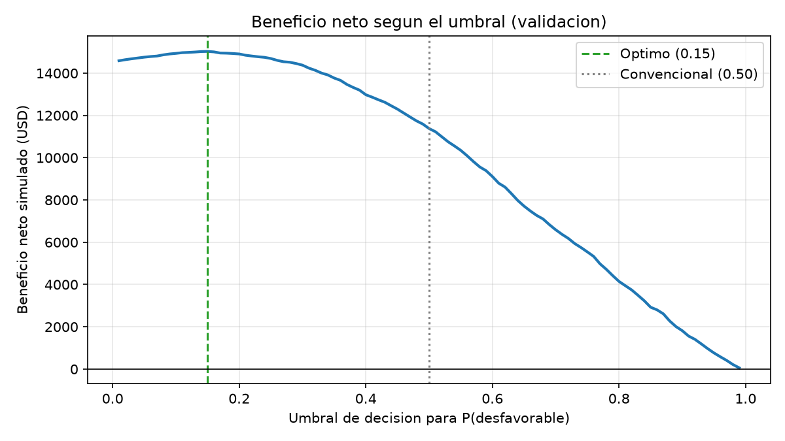

# Umbral de decisión mediante una matriz de costos (US-08)

El modelo seleccionado en la US-06 (Regresión Logística, que también superó a la
BiGRU de la US-07) entrega cinco probabilidades por reseña. Esta historia convierte
esas probabilidades en una decisión de negocio, revisar o no una reseña, y elige el
umbral que maximiza el beneficio neto simulado en lugar de usar el valor
convencional de 0.5.

## 1. Estrategia de decisión

- **Reseña desfavorable:** etiquetas 0 y 1 (una y dos estrellas).
- **Probabilidad desfavorable:** `P(desfavorable) = P(etiqueta 0) + P(etiqueta 1)`.
- **Regla:** si `P(desfavorable) >= umbral`, la reseña pasa a una cola donde un
  agente de experiencia del cliente la lee y, si es una queja real, contacta al
  cliente. No se toma ninguna acción automática, en línea con el alcance del proyecto.

**Justificación.** Una y dos estrellas expresan insatisfacción clara. Además, la
principal confusión del modelo ocurre entre esas dos etiquetas (261 y 221 errores
en la matriz de la US-06), y agruparlas elimina ese error del problema de negocio.
Las reseñas de tres estrellas son mixtas; incluirlas llenaría la cola de reseñas
que no son quejas.

## 2. Escenario de simulación

Tienda en línea en El Salvador con un equipo de experiencia del cliente o
retención. Valores en USD.

| Supuesto | Valor | Justificación |
|---|---:|---|
| Salario mensual del agente | $750 | Punto medio del rango de $700 a $800 para puestos de experiencia del cliente |
| Costo patronal | 25.9 % | Aportes patronales oficiales (ISSS, AFP, aguinaldo y vacaciones) |
| Jornada | 44 h/semana (190.7 h/mes) | Jornada ordinaria en El Salvador |
| Shrinkage | 30 % | Extremo superior del rango habitual de 20 % a 30 % (pausas, capacitación, reuniones) |
| **Costo por minuto productivo** | **$0.118** | $750 × 1.259 ÷ (190.7 h × 0.70) ÷ 60 |
| Tiempo de revisión | 5 min | Leer la reseña y decidir si es una queja |
| Tiempo de contacto | 10 min adicionales | Llamada o correo y nota de resolución; es un promedio |
| Valor anual del cliente | $100 | Gasto anual típico en la tienda |
| Abandono sin contacto | 35 % | Cliente insatisfecho al que nadie atiende |
| Abandono con contacto | 25 % | La recuperación del servicio reduce el abandono |

El costo laboral cargado antes del shrinkage es de $4.95 por hora, coherente con el
valor referencial de $5.00 por hora de la
[evaluación de viabilidad](evaluacion-viabilidad.md) (US-11).

## 3. Matriz de costos

| Resultado | Qué ocurre | Cálculo | Costo |
|---|---|---|---:|
| Verdadero positivo (VP) | Se marca y era desfavorable: se contacta al cliente | 0.25 × $100 + 15 min × $0.118 | $26.77 |
| Falso positivo (FP) | Se marca pero no era desfavorable: tiempo perdido | 5 min × $0.118 | $0.59 |
| Falso negativo (FN) | No se marca y era desfavorable: nadie contacta | 0.35 × $100 | $35.00 |
| Verdadero negativo (VN) | No se marca y no era desfavorable | — | $0.00 |

El beneficio neto se mide frente a no revisar ninguna reseña:

```text
Beneficio neto = VP × (costo FN − costo VP) − FP × costo FP
               = VP × $8.23 − FP × $0.59
```

Detectar una reseña desfavorable vale unas 14 veces más que una falsa alarma, por
lo que se espera un umbral óptimo inferior a 0.5. Además:

- El costo del agente casi no cambia el resultado: aun usando solo el salario, sin
  costo patronal ni shrinkage, la relación sigue siendo de 27 a 1.
- El ahorro depende de la **reducción** del abandono (10 puntos), no de su nivel.

## 4. Metodología

- Probabilidades del pipeline guardado por la US-06
  (`models/ml_20261102_final/best_model.joblib`).
- Se evalúan los umbrales de 0.01 a 0.99, en pasos de 0.01, sobre **validation**
  (4,918 reseñas), que la US-06 dejó disponible para experimentos posteriores.
- El umbral elegido y el de 0.5 se aplican una sola vez a **test** (4,931 reseñas)
  para reportar el resultado, de modo que el umbral no se ajusta con los datos de prueba.
- Sensibilidad: se repite la elección con un valor anual del cliente de $50, $100 y $200.

## 5. Ejecutar

Requiere los archivos de la US-06 (ver [modelos-clasicos.md](modelos-clasicos.md)). Después:

```bash
python -m src.modelos.evaluar_umbrales
```

El comando escribe en `reports/umbral/`:

- `umbrales_validacion.csv`: VP, FP, FN, VN, precisión, recall, costo total y beneficio neto por umbral.
- `curva_beneficio_neto.png`: curva de beneficio neto con el umbral óptimo y el de 0.5.
- `resultados.json`: supuestos, umbral elegido, comparación en test y sensibilidad.

Rechaza un directorio de salida existente; usa `--output` con otro nombre para repetir la ejecución.

## 6. Resultados

El umbral que maximiza el beneficio neto en validation es **0.15**. Aplicado a test:

| Umbral | Reseñas marcadas | VP | FP | FN | Recall | Precisión | Beneficio neto |
|---|---:|---:|---:|---:|---:|---:|---:|
| **0.15 (óptimo)** | 3,628 | 1,948 | 1,680 | 35 | 98.2 % | 53.7 % | **$15,044.10** |
| 0.50 (convencional) | 1,755 | 1,408 | 347 | 575 | 71.0 % | 80.2 % | $11,385.09 |

El umbral óptimo genera **$3,659.01 más (+32 %)** que el de 0.5, un resultado casi
idéntico al observado en validation (+$3,649), por lo que el umbral se mantiene en
datos no utilizados para elegirlo. Con 0.5 se pierden 575 clientes insatisfechos;
con 0.15, solo 35.



**Ejemplo real.** Entre las cinco primeras reseñas de una estrella de validation,
dos tienen una probabilidad desfavorable de 0.37 y 0.43: con el umbral de 0.5 no se
marcarían, aunque son quejas reales escritas con un tono más moderado.

### Sensibilidad

| Valor anual del cliente | Umbral óptimo | Beneficio en test | Beneficio con 0.50 | Diferencia |
|---:|---:|---:|---:|---:|
| $50 | 0.24 | $5,367.08 | $4,345.09 | +$1,021.99 |
| **$100** | **0.15** | **$15,044.10** | **$11,385.09** | **+$3,659.01** |
| $200 | 0.11 | $34,735.39 | $25,465.09 | +$9,270.30 |

Cuanto más vale un cliente, más bajo debe ser el umbral. En los tres escenarios el
umbral óptimo supera a 0.5, por lo que la conclusión no depende de un supuesto exacto.

### Capacidad del equipo

| Umbral | Minutos de trabajo (VP × 15 + FP × 5) | Horas productivas | Agentes necesarios |
|---|---:|---:|---:|
| 0.15 | 37,620 | 627 | ≈ 4.7 |
| 0.50 | 22,855 | 381 | ≈ 2.9 |

Cada agente aporta unas 133.5 horas productivas al mes (190.7 h × 0.70). El
beneficio neto ya descuenta el tiempo de los agentes, pero supone que el equipo
puede atender todo el volumen marcado.

### Justificación del umbral

Se recomienda **0.15** si el equipo puede absorber el volumen. La curva es plana
alrededor del óptimo: en validation, subir el umbral a 0.20 reduce las reseñas
marcadas un 9 % (de 3,717 a 3,382) y solo cuesta $120 (−0.8 %); con 0.25 el trabajo
baja un 17 % (3,089 reseñas) a cambio de $335 (−2.2 %). Volver a 0.5, en cambio,
cuesta $3,649 (−24 %). Si la capacidad está limitada, conviene elegir el umbral más
bajo que el equipo pueda atender dentro de esa zona, en lugar de volver a 0.5.

## 7. Limitaciones

- Los valores económicos son supuestos de simulación, no datos de una empresa real.
- El dataset está equilibrado: el 40 % de las reseñas son desfavorables. Una tienda
  real suele tener una proporción menor, lo que reduce el beneficio total.
- Los volúmenes de capacidad corresponden a unas 4,900 reseñas, no a un mes real de operación.
- Las probabilidades de la Regresión Logística no se calibraron; el umbral óptimo
  depende de este modelo y de su muestra de 10,000 reseñas de entrenamiento.

## 8. Pruebas

```bash
pytest tests/test_evaluacion_umbrales.py -v
```

Las 11 pruebas pasaron. Cubren los costos del escenario base, la suma de
probabilidades según el orden de clases, la exclusión de tres estrellas, el conteo
de VP, FP, FN y VN en un ejemplo calculado a mano, la fórmula del beneficio neto, el
rango de 0.01 a 0.99, la elección del mejor umbral y la ejecución completa del comando.

La suite completa dio 84 exitosas y 7 errores. Los siete corresponden a las pruebas
de PySpark por falta de Java en el entorno local y no están relacionados con esta historia.